# SR2 — Integração Ubuntu ↔ Windows Server (AD DS, SSSD, PAM e SMB)

**Grupo 10 · Registo de experiência laboratorial · 31/10/2026**  
**Estado:** AD DS, autenticação Linux por SSSD/PAM e acesso SMB validados. **Winbind e GPO em modo de aplicação obrigatória: pendentes.**

## 1. Objetivo e ambiente

Implementar um laboratório privado em Proxmox para autenticar utilizadores do Active Directory (AD) num cliente Ubuntu e permitir acesso a uma partilha SMB alojada no Windows Server. Este procedimento servirá de base para um futuro guião reprodutível do Grupo 10.

| Componente | Configuração observada |
|---|---|
| Hipervisor | Proxmox VE 9.2.21 (`pve-laceds04`) |
| VM Windows | `110213`, Windows Server 2025, `SR2-DC01`, `192.168.103.3/24` |
| VM Linux | `110211`, Ubuntu 26.04.1 LTS, `ubuntuclient`, `192.168.103.4/24` |
| Rede | `192.168.103.0/24`, bridge `vmbr103`, gateway `192.168.103.1` |
| Domínio de laboratório | `isec.local` (NetBIOS: `ISEC`) |
| DNS do AD | `192.168.103.3` |
| Conta de teste | `aluno.sr2@isec.local` |

A rede corresponde à **LAN C do Grupo 10** na página 4 das instruções do laboratório. A infraestrutura é **privada**, sem publicação de portas/serviços para a Internet. O domínio `isec.local` foi mantido como decisão do grupo, independentemente de nomes exemplificativos no README do [TrabalhoSR2](https://github.com/orlandonss/TrabalhoSR2).

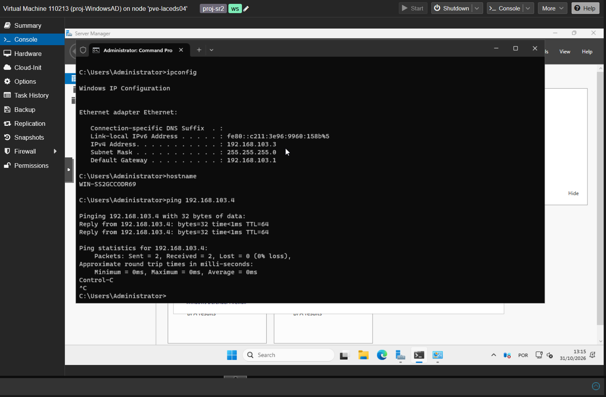

## 2. Preparação da rede e do Windows Server

O Windows foi criado através de **Full Clone** de um template existente: disco independente e menor risco de modificar o template. Definiu-se IP estático, necessário para que os clientes localizem permanentemente o controlador de domínio. O Windows foi renomeado para `SR2-DC01`.

```powershell
Rename-Computer -NewName "SR2-DC01" -Restart
hostname
ipconfig /all
```

Inicialmente, o Windows conseguia fazer ping ao Ubuntu, mas o inverso falhava. Foi criada uma regra ICMPv4 restrita ao cliente Linux, **sem desativar a firewall**:

```powershell
New-NetFirewallRule -DisplayName "SR2 - Allow ICMPv4" -Direction Inbound `
  -Protocol ICMPv4 -IcmpType 8 -Action Allow -Profile Any `
  -RemoteAddress 192.168.103.4
```

Resultado: comunicação bidirecional, sem perda de pacotes.

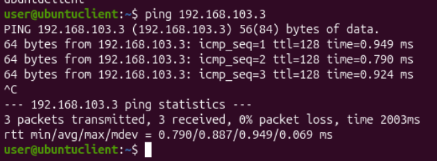

## 3. Instalação do Active Directory e DNS

No Windows Server foi instalada a função AD DS e criada uma **nova floresta isolada** `isec.local`. A criação da floresta também instalou o DNS; foi pedida uma palavra-passe DSRM para recuperação, distinta da autenticação habitual.

```powershell
Install-WindowsFeature AD-Domain-Services -IncludeManagementTools
Install-ADDSForest -DomainName "isec.local" `
  -DomainNetbiosName "ISEC" -InstallDNS -Force
```

Após o reinício, foram validados o domínio, o controlador e os serviços:

```powershell
Get-ADDomain
Get-ADDomainController
Get-Service DNS,NTDS
```

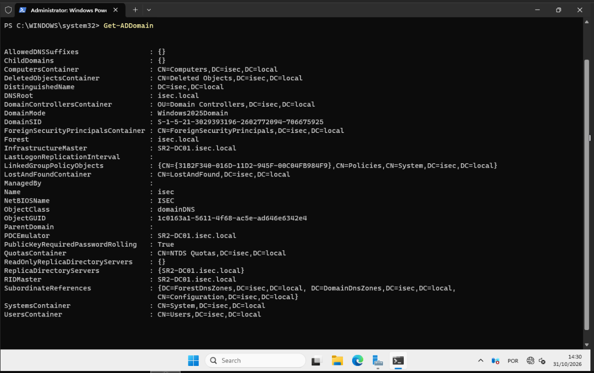
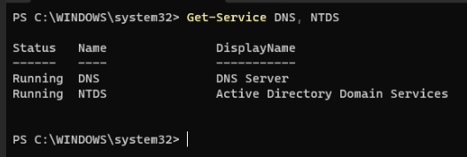

**Decisão DNS:** a interface do controlador foi configurada para usar o seu próprio DNS (`192.168.103.3`); a resolução externa é encaminhada pelo serviço DNS para `1.1.1.1`. Não se coloca DNS público como DNS alternativo nos clientes do AD, pois pode falhar a descoberta dos registos internos.

```powershell
Set-DnsClientServerAddress -InterfaceAlias "Ethernet" -ServerAddresses 192.168.103.3
Add-DnsServerForwarder -IPAddress 1.1.1.1  # apenas se ainda não existir
Resolve-DnsName SR2-DC01.isec.local
Resolve-DnsName _ldap._tcp.dc._msdcs.isec.local -Type SRV
```

O registo SRV devolveu `0 100 389 sr2-dc01.isec.local`: **prioridade 0**, **peso 100**, **porta LDAP 389** e destino do serviço.

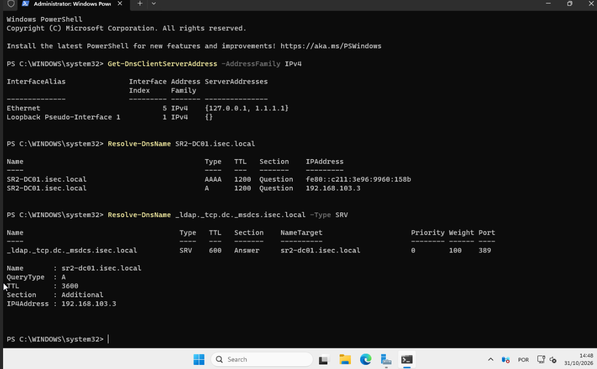

## 4. Integração do Ubuntu no domínio — SSSD

Foi mantido o endereço `192.168.103.4` e alterado apenas o DNS da ligação NetworkManager `lab103` (`ens18`). Esta escolha é essencial para descobrir o AD; o ficheiro `/etc/hosts` **não substitui** os registos SRV do DNS.

```bash
sudo nmcli connection modify 'lab103' \
  ipv4.dns '192.168.103.3' ipv4.dns-search 'isec.local' \
  ipv4.ignore-auto-dns yes
sudo nmcli device reapply ens18
resolvectl status ens18

dig @192.168.103.3 SR2-DC01.isec.local A +short
dig @192.168.103.3 _ldap._tcp.dc._msdcs.isec.local SRV +short
ping -c 3 google.com
```

Foram confirmadas a resolução interna e a resolução externa através do DNS do Windows.

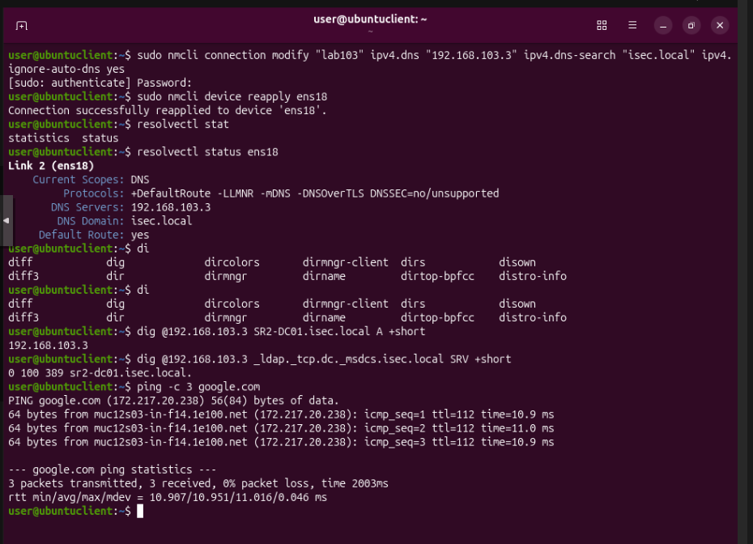

Foram instalados os componentes de descoberta, associação ao domínio e autenticação:

```bash
sudo apt update
sudo apt install -y realmd sssd-ad sssd-tools adcli \
  libnss-sss libpam-sss krb5-user samba-common-bin dnsutils
sudo realm -v discover isec.local
sudo realm join -v isec.local -U Administrator
realm list
```

`realm discover` identificou um AD com Kerberos e cliente SSSD; `realm list` confirmou `configured: kerberos-member`. O Windows mostrou o objeto de computador `UBUNTUCLIENT` no AD. **SSSD** fornece identidades/autenticação; **NSS** expõe utilizadores/grupos ao Linux; **PAM** controla as etapas de login.

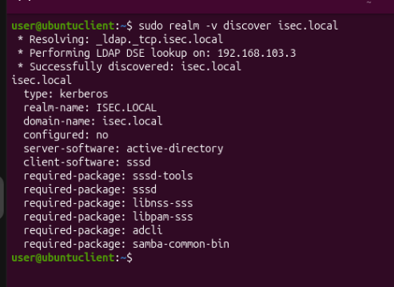
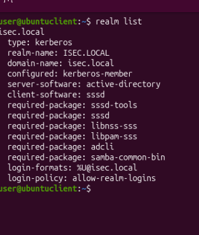
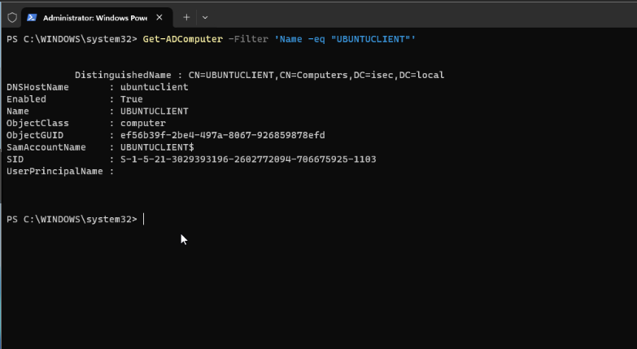

## 5. Utilizador do domínio e autenticação PAM

Criou-se uma conta exclusivamente no **Active Directory** (não uma conta local Linux):

```powershell
New-ADUser -Name "Aluno SR2" -SamAccountName "aluno.sr2" `
  -UserPrincipalName "aluno.sr2@isec.local" `
  -AccountPassword (Read-Host "Password" -AsSecureString) -Enabled $true
Get-ADUser aluno.sr2 -Properties Enabled
```

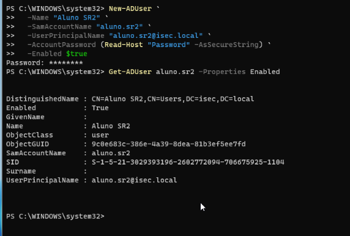

No Ubuntu, SSSD resolveu corretamente a identidade e os grupos:

```bash
id aluno.sr2@isec.local
getent passwd aluno.sr2@isec.local
sudo pam-auth-update --enable mkhomedir
```

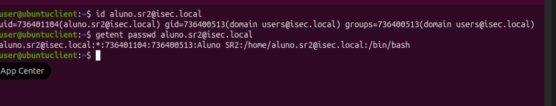

### Incidente: `su: System error`

O primeiro `su - 'aluno.sr2@isec.local'` falhou. A pasta pessoal não chegou a ser criada. Os registos mostraram `pam_sss(su-l:account): Access denied ... 4 (System error)` e `sssctl user-checks` devolveu `pam_acct_mgmt: System error`. O serviço SSSD estava online e via o DC, pelo que o erro se encontrava na **autorização de conta**, não na descoberta DNS nem no NSS.

O validador `sssctl config-check` detetou ainda a opção `config_file_version = 2` como não aceite nesta versão de SSSD; a linha foi removida. Para isolar a hipótese de aplicação de GPO, foi colocado temporariamente na secção `[domain/isec.local]` do ficheiro `/etc/sssd/sssd.conf`:

```ini
ad_gpo_access_control = permissive
```

```bash
sudo cp -a /etc/sssd/sssd.conf /etc/sssd/sssd.conf.bak
# editar /etc/sssd/sssd.conf, removendo config_file_version e adicionando a opção acima
sudo chmod 600 /etc/sssd/sssd.conf
sudo sssctl config-check
sudo systemctl restart sssd
sudo sssctl user-checks 'aluno.sr2@isec.local' --action acct --service su-l
su - 'aluno.sr2@isec.local'
whoami
pwd
```

**Resultado:** `pam_acct_mgmt: Success`; login AD aceite; PAM criou automaticamente `/home/aluno.sr2@isec.local`. O teste demonstra autenticação e sessão funcional. **Limitação:** o modo `permissive` não impõe as GPO; a causa exata do bloqueio inicial ainda não foi demonstrada. É necessário rever as políticas/regras antes de passar a `enforcing`.

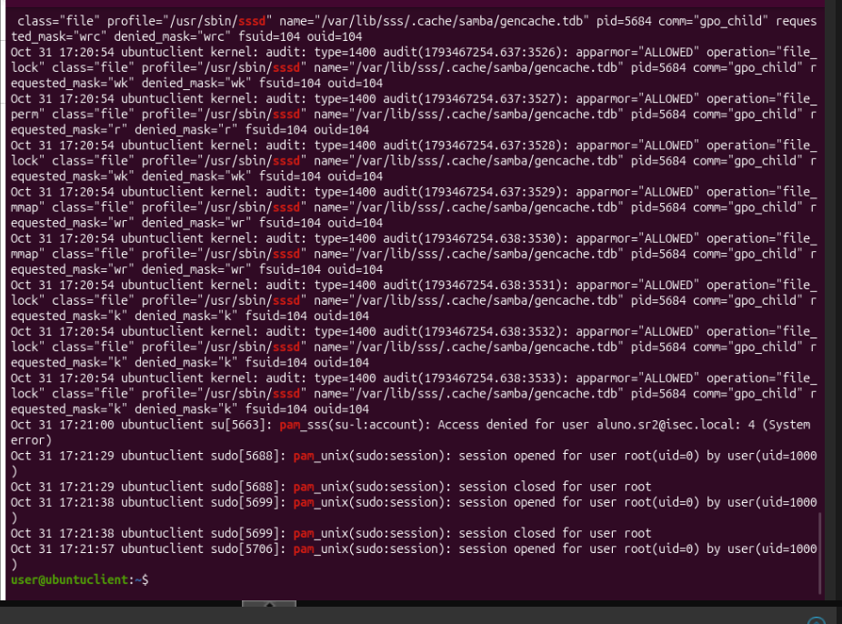
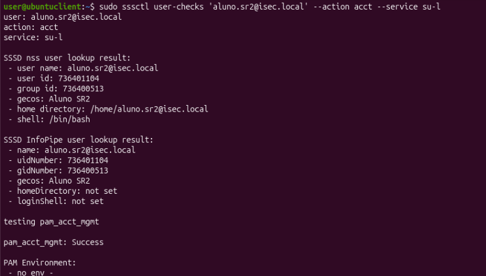
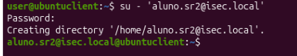

## 6. Partilha SMB Windows ↔ Linux

Para validar o acesso a recursos remotos com credenciais AD, foi criada uma partilha **no Windows** (servidor SMB) e acedida a partir do Ubuntu (cliente Samba). Isto **não equivale** a configurar um servidor Samba Linux nem prova integração Winbind.

```powershell
New-Item -Path 'C:\SR2-Partilha' -ItemType Directory -Force
icacls 'C:\SR2-Partilha' /grant 'ISEC\aluno.sr2:(OI)(CI)M'
New-SmbShare -Name 'SR2' -Path 'C:\SR2-Partilha' -ChangeAccess 'ISEC\aluno.sr2'
Get-SmbShare -Name SR2
```

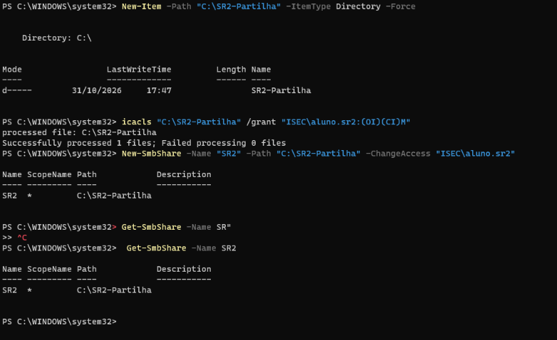

```bash
sudo apt install -y smbclient cifs-utils
smbclient //sr2-dc01.isec.local/SR2 -U 'ISEC\aluno.sr2'
# Na consola smb: \\> executar:
ls
mkdir teste-linux
ls
exit
```

O comando `mkdir teste-linux` foi aceite e a nova pasta surgiu na listagem. Confirma-se autenticação SMB e permissão de escrita com a conta AD.

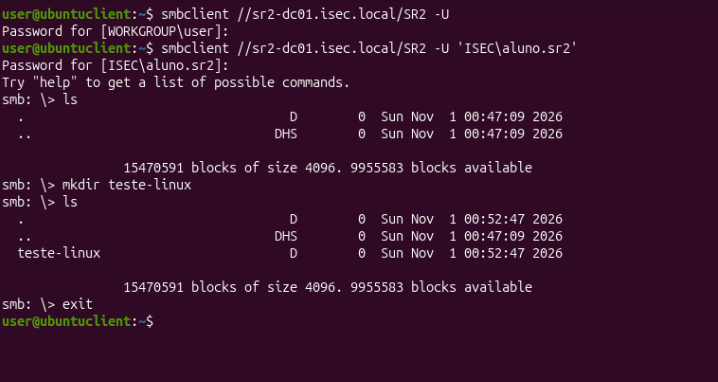

## 7. Conclusão, limitações e continuidade

**Comprovado por capturas:** rede bidirecional; AD DS/DNS operacional; Ubuntu associado ao AD; resolução de identidades por SSSD; login por PAM com criação de home; acesso de leitura/escrita à partilha SMB Windows.

**Pendente:** (1) identificar e corrigir a política GPO que exigiu `ad_gpo_access_control = permissive`; (2) implementar/testar **Winbind** como alternativa ao SSSD, preferencialmente numa VM separada ou clone com identidade/IP diferentes; (3) integrar experiências dos colegas e produzir um guião de aula integralmente reproduzível. Num laboratório escolar, não é obrigatório clonar para usar Winbind; o clone é uma **medida de isolamento e reversibilidade**, para não destruir uma configuração SSSD já validada.

**Nota de reprodutibilidade:** o laboratório usa configurações e nomes específicos do Grupo 10. Noutro ambiente devem ser adaptados IP, bridge e domínio. As palavras-passe nunca devem ser colocadas no relatório. O serviço SMB foi demonstrado num DC apenas para fins laboratoriais, não como arquitetura de produção recomendada.

### Referências de trabalho

- Repositório do grupo: <https://github.com/orlandonss/TrabalhoSR2>
- Instruções Proxmox LEIRASLab, ficheiro disponibilizado na conversa, pp. 4, 7–8.
- Ubuntu Server — SSSD com Active Directory: <https://ubuntu.com/server/docs/how-to/sssd/with-active-directory/>
- Ubuntu Server — integração AD com Winbind: <https://ubuntu.com/server/docs/how-to/active-directory/join-a-domain-with-winbindpreparation/>
